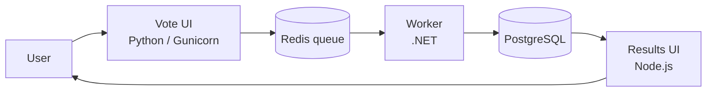
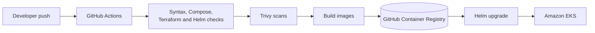

# Architecture

## Runtime flow

The vote service writes each selection to Redis. The worker consumes the latest selection and persists it in PostgreSQL. The result service reads PostgreSQL and streams updated totals to the browser.

## Delivery flow

Images are tagged with the Git commit SHA, making every deployment traceable to an exact source revision. The deployment job authenticates to AWS through GitHub OIDC rather than stored access keys.

## Kubernetes topology

- `vote` and `result` are stateless Deployments exposed through internal ClusterIP Services.
- `worker` is a stateless Deployment with no Service because it does not accept inbound traffic.
- Redis is a single-replica Deployment used as a transient queue.
- PostgreSQL is a StatefulSet backed by a persistent volume claim.
- Readiness and liveness probes prevent unhealthy web pods from receiving traffic.
- CPU and memory requests and limits constrain each workload.
